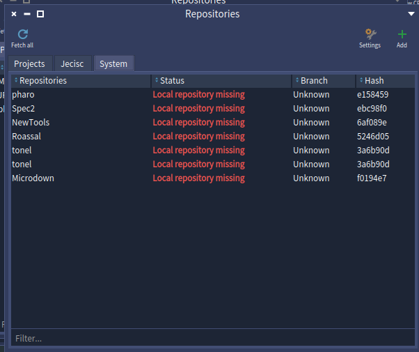
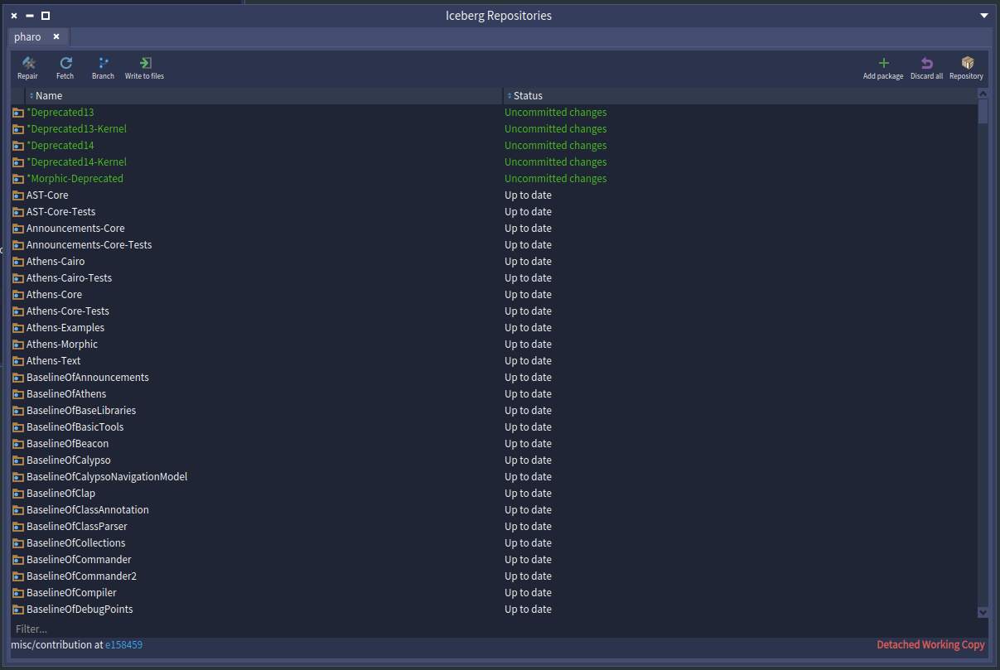
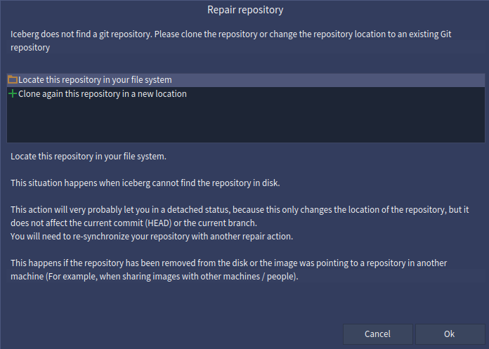
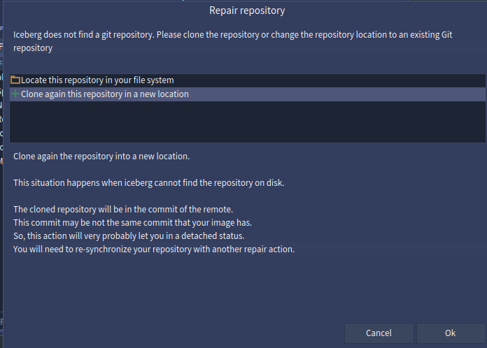
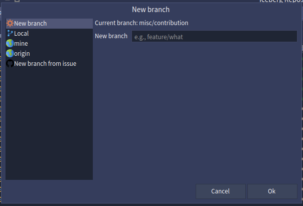
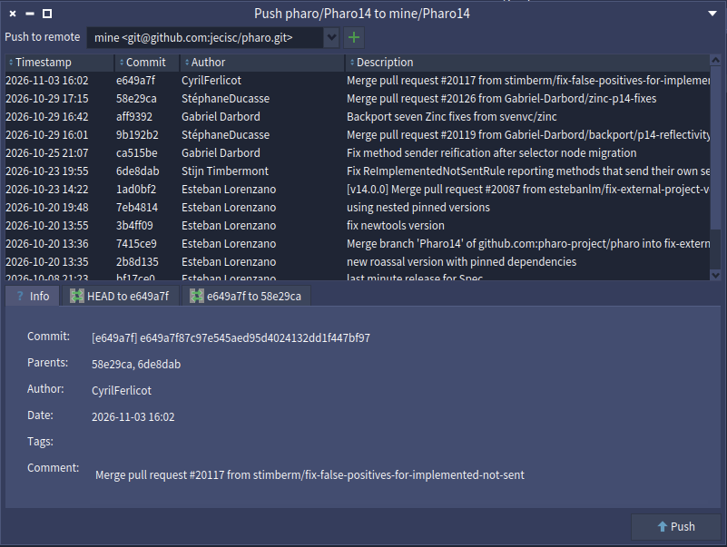

# How to contribute

Thank you for helping to improve Pharo! If you want an overview first, watch the short talk [Contributing to Pharo](https://www.youtube.com/watch?v=AtjEgK3lBPE&list=PLJ5nSnWzQXi_7LGwiSa-8VwYXELwFQLBt&index=33) from ESUG 2022, where Stéphane Ducasse shares tips on how anyone can help.

You can also talk to us on the [Pharo Discord server](https://discord.gg/QewZMZa) or on the pharo-dev mailing list.

## Reporting issues

If you found a bug or have an idea, open an issue on the [issue tracker](https://github.com/pharo-project/pharo/issues).

### How to report a bug

* Use the latest stable or the latest development version of Pharo. Use the latest virtual machine too (see the [download page](https://pharo.org/download)).
* Check that you can reproduce the bug.
* Search the issue tracker first, to see if the bug is already reported.
* Open a new issue with the steps to reproduce it, what you expected, and what happened.
* Give the version of the virtual machine, your operating system, and any other detail that matters.
* If you are not sure whether it is a bug, ask on Discord or on pharo-dev first.
* Follow your issue. A later fix may solve it, and you can help verify and close it.

## Use of AI tools

We accept contributions made with the help of AI tools (for example coding assistants and chat models), under the following conditions.

1. **You review all the work yourself before you submit it.** You are responsible for every line of your pull request, whatever tool wrote it. Read the code, run the tests, and understand what the change does and why. Do not submit code that you cannot explain.
2. **Write good commits and pull request descriptions, in simple English.** Reviewers read many changes. Write messages that are short and easy to understand, in simple English. The messages can be longer if the issue is complex. Messages that are too long, vague or full of filler will be asked to be rewritten.
3. **Repeated problems end the collaboration.** If a contributor's pull requests keep containing problems that a simple human review should have fixed, we will stop accepting pull requests from that contributor.

Maintainers may ask you questions about your change. Be ready to answer them yourself.

## Proposing a fix or an enhancement

You do not need to open an issue first. If an issue already exists, reference it in the pull request (step 8).

An older [TechTalk recording](https://www.youtube.com/watch?v=90T0OSb_Fuo) shows the same Iceberg workflow on two small issues. The Pharo version and the screens are older, but the steps are the same.

### 1. Get a Pharo image

You need a Pharo 15 image. Choose the way you prefer:

* **Pharo Launcher** (recommended): download it from the [download page](https://pharo.org/download) and follow the [installation guide](https://pharo-project.github.io/pharo-launcher/installation/). In the launcher, create a new image from the Pharo 15 development template and start it.
* **Command line**: from an empty folder, download the latest Pharo 15 image and virtual machine, then start the image:

```bash
curl -L https://get.pharo.org/150 | bash
curl -L https://get.pharo.org/vm150 | bash
./pharo-ui Pharo.image
```

### 2. Fork the repository

The first time only, fork [pharo-project/pharo](https://github.com/pharo-project/pharo) on GitHub. You need a GitHub account. Your branches will be pushed to your fork, and pull requests go from your fork to the main repository.

### 3. Set up Iceberg

Iceberg is the Git client built into Pharo. It is already in the image. Set up the credentials it uses to push to your fork:

* **SSH keys on Linux or macOS**: load your key into the SSH agent. Add the command to your shell profile so it runs in every new shell:

```bash
ssh-add ~/.ssh/id_ed25519
```

* **SSH keys on Windows**: generate a key pair and add the public key to your GitHub account. Then set the key in Iceberg as described below.
* **Custom SSH keys in Iceberg**: open the Iceberg settings, search for "Use custom SSH keys", and enter the paths of your public and private keys. You can also run this in a Playground in the image, replacing the paths with yours:

```smalltalk
IceCredentialsProvider useCustomSsh: true.
IceCredentialsProvider sshCredentials
	publicKey: '/path/to/id_ed25519.pub';
	privateKey: '/path/to/id_ed25519'
```

* **HTTPS**: add a GitHub token in the Iceberg credentials settings instead.

### 4. Set up the Pharo repository in Iceberg

The image already knows the Pharo repository, but not where your clone is. Open the Iceberg repositories window and go to the **System** tab. The `pharo` repository is listed there with the status **Local repository missing**:



Open the `pharo` repository. Its window has a **Repair** icon in the toolbar, next to Fetch, Branch and Write to files. Click it to repair the repository:



Iceberg offers two options:

1. **Locate this repository in your file system**: point Iceberg to the clone of your fork that is already on your disk. Choose this if you already have a clone.

   

2. **Clone again this repository in a new location**: clone your fork into a folder you choose. Use this option if you do not have a local clone yet. The clone starts at the commit of the remote, which may differ from the commit your image has, so you will then need to fetch and create a branch (see below).

   

After the repair:

* If the repository shows **Fetch required**, it means the image was built from a commit that your clone does not have yet. Run the fetch from the repair menu.
* Usually, after the fetch, the repository is in the **Detached Working Copy** state. The image commit and the repository commit differ, so create a new branch from the current commit. This is the step that makes the rest of the work possible.

> **Only if you work on several fixes:** name this first branch `sync`. It points to the commit where your clone and your image agree. Each fix then starts from `sync`, and you can go back to a clean state in one click. If you only make one fix, skip this and branch directly from the current commit.

### 5. Create a branch for your change

In the `pharo` repository window, click **Branch**. The New branch dialog opens. It shows the current branch and a field for the name of the new branch:



The left side of the dialog lists the other ways to create a branch: **New branch**, **Local**, your fork (**mine**), **origin**, and **New branch from issue**.

* Create each change on its own branch. If you made a `sync` branch, start each change from it. This keeps each pull request small and independent.
* If the change is for an issue, use **New branch from issue**.
* Otherwise, type a name that describes the change, such as `fix-nil-check-clybrowser`.

### 6. Make your change

* Keep one logical change per branch and per pull request. Small, focused pull requests are reviewed faster.
* Add or update tests in the `src/*-Tests` packages.
* Edit existing methods minimally. Do not reformat code you do not change, so that the reviewer sees only the real change.
* Give every new class a class comment.
* In Pharo code, do not reference `Smalltalk` directly. Use `self class environment` if you need to access the environment.
* Check your changed code with Renraku, the in-image critiques.
* Some parts of Pharo live in other repositories, such as Spec, NewTools, Iceberg, Roassal, Toplo and Microdown. If your change belongs to one of them, make the pull request in that repository instead.

### 7. Commit and push

In Iceberg, commit your change, then push the branch to your fork. In the `pharo` repository window, click **Push**. The Push dialog shows the branch and the remote to push to. Choose your fork as the remote, then click **Push**:



* Write a short subject that says what the commit does, for example "Fix nil check in ClyBrowser".
* Add a body only when the reason is not clear from the diff.
* Add `Fixes #XXXXX` at the end when the commit fixes an issue.

Pushing your branch also pushes the Pharo commits it is based on, so your fork stays in sync with the main repository. You do not need to resync your fork by hand.

### 8. Create the pull request

Create the pull request from your fork against the `Pharo15` branch of `pharo-project/pharo`. In Iceberg, right-click the repository, open the **GitHub** plugin, and choose **Create pull request**. You can also open it on GitHub.

* Use a short title that says what the change does.
* In the description, say what the issue is, what the fix is, and how you tested it.
* If the change is for an issue, write `Fixes #XXXXX` in the description, where `XXXXX` is the issue number. GitHub then closes the issue when the pull request is merged. If there is no issue, leave this line out.
* A pull request needs at least one review before it is merged.

The CI starts automatically. Open the check details on the pull request to see the Jenkins job. To update the pull request after review, commit and push to the same branch. You do not need to open a new one.

### 9. After the pull request is merged

* Delete your branch from your fork.
* If the pull request had `Fixes #XXXXX`, the issue is closed automatically.

## Code of conduct and security

Please follow our [code of conduct](CODE_OF_CONDUCT.md). To report a security issue, read [SECURITY.md](SECURITY.md) and do not open a public issue.

## License

Pharo is released under the MIT License (see [LICENSE](LICENSE)). By contributing, you agree that your contribution is distributed under the same license.
