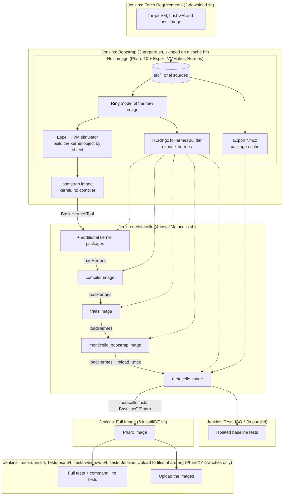

# The Pharo bootstrap

The bootstrap builds a Pharo image from the sources of this repository, instead of modifying an existing image. It is the only way to build Pharo: every image published on files.pharo.org comes from it.

The idea: a **host** image (an older Pharo with the bootstrap tools) reads the sources, builds a minimal **kernel** image object by object, then exports the packages that the kernel needs to grow. The kernel then loads, step by step, a compiler, the traits, Monticello, Metacello and finally the whole of Pharo.

- [Overview](#overview)
- [Running it](#running-it)
- [1. Clean](#1-clean)
- [2. Download](#2-download)
- [3. Prepare: building the kernel with Espell](#3-prepare-building-the-kernel-with-espell)
- [4. Hermes: from the kernel to Metacello](#4-hermes-from-the-kernel-to-metacello)
- [5. Full image](#5-full-image)
- [Tests](#tests)
- [The CI](#the-ci)
- [Where to change what](#where-to-change-what)

## Overview

Each box is a stage of the Jenkins pipeline, named as in the `Jenkinsfile`.



| Step | Script | Runs in | Produces |
|---|---|---|---|
| 1. Clean | `1-clean.sh` | shell | an empty `build/` |
| 2. Download | `2-download.sh` | shell | the target VM, the host VM and image, the icons |
| 3. Prepare | `3-prepare.sh` | host image | `bootstrap.image`, the `.hermes` and `.mcz` files, the package lists |
| 4. Hermes and Metacello | `4-installMetacello.sh` | the new image | the compiler, traits, Monticello and Metacello images |
| 5. Full image | `5-installIDE.sh` | the new image | `Pharo.image` |

## Running it

```bash
./bootstrap/scripts/bootstrap.sh
```

`bootstrap.sh` runs the five scripts in order. They can also be run one by one, which helps when working on a step: run 1 to 3 once, then rerun 4 or 5. `snapshot.sh` and `restore.sh` save and restore the build folder between runs.

The configuration is in `envvars.sh` and `envversion.sh`:

- `BOOTSTRAP_ARCH` (default 64) and `BUILD_NUMBER` (default 0).
- `BOOTSTRAP_VMTARGET` to use your own VM for the new image, for example when testing a VM change.
- The Pharo version comes from the last git tag (`git describe`), so the checkout needs its tags.

Everything is written to `build/`: the downloads in `build/bootstrap-downloads`, the images and intermediate files in `build/bootstrap-cache`.

## 1. Clean

`1-clean.sh` deletes the output of the previous run. The CI starts from an empty workspace and skips it.

## 2. Download

`2-download.sh` gets:

- **The target VM**, the one that runs the new image, for the version being built (`getPharoVM.sh`). It is skipped when `BOOTSTRAP_VMTARGET` is set.
- **The host VM and image.** The host image is `bootstrapImage.zip`, a release of the [PharoBootstrap](https://github.com/pharo-project/PharoBootstrap) repository: a Pharo 10 image with Espell and VMMaker loaded. It runs on a Pharo 10 VM (`getPharoVM.sh 100`).
- The icon packs, which the full image loads.

## 3. Prepare: building the kernel with Espell

`3-prepare.sh` runs two scripts in the host image:

1. `prepare_image.st` loads `BaselineOfPharoBootstrapProcess` from `src/`: the `PharoBootstrap` package and its dependencies, among them Hermes (from its [own repository](https://github.com/pharo-project/hermes)). It retries once on a known zlib error of Iceberg in Pharo 10.
2. `bootstrap.st` runs `PBBootstrap fromCommandLine bootstrap`.

`BaselineOfPharoBootstrap` defines what goes in the kernel and what is exported. Its groups are read by `PBBootstrap`: `KernelGroup` for the kernel, `ToLoadByHermes` for the `.hermes` files and `ToExportAsMCZ` for the `.mcz` files.

### Preparing the exports

`PBBootstrap>>prepareBootstrap`:

- **Kernel protocols:** writes the protocols of the kernel methods to `protocolsKernel.txt`. The kernel is built without them, and they are restored in step 4.
- **Source package names:** writes `bootstrapSourcePackages.txt`, the list of packages read by the bootstrap. The CI uses it as the key of the bootstrap cache.
- **`.mcz` files:** exports the packages to the Monticello package cache. The `.hermes` files have no source code, so these are reloaded later to give every class its source and package information.
- **Package lists:** writes one `hermes*Packages.txt` file per phase of step 4. The lists come from the baselines (`BaselineOfCompiler corePackageNames`...), so the packages are listed only once, in the baselines.
- **`.hermes` files:** builds a Ring model of the packages to export, then writes one `.hermes` file per package with `HERing2ToHermesBuilder`. The methods are compiled at this point, by the host's compiler, against the Ring model.

### Building the kernel

`PBBootstrap>>createImage` then builds the kernel from a Ring model of the kernel packages. The image builder (`PBAbstractImageBuilder` and `PBImageBuilder64bit`) uses [Espell](https://github.com/guillep/espell) on top of the VM simulator of VMMaker:

- **The object space** is the memory of a simulated Spur VM. Espell gives mirrors on its objects, so the host can create and modify objects in the new image.
- **VM stubs:** it first creates the objects the VM needs before any code runs: `nil`, `true`, `false`, the class table, the special objects array, and stubs for the classes the VM knows (`SmallInteger`, `Array`, `ByteString`...).
- **Initial objects and classes:** it creates the classes from the Ring model, then the globals (`Smalltalk`, `Undeclared`...).
- **Methods:** each method is compiled in the host with Espell's cross compiler, against the new image's classes, and installed in the object space. Then the extension methods.
- **Initialization:** Espell's AST interpreter runs code inside the new image (class initializations, the process scheduler), and the image builder installs a first process that will run `PharoBootstrapInitialization` at startup.

The result is `bootstrap.image`: a kernel with no compiler, no source code and no protocols. Assertions are disabled during the build for speed.

## 4. Hermes: from the kernel to Metacello

`4-installMetacello.sh` grows the kernel with the target VM. Each phase saves a new image, zipped as a build artifact:

1. **Kernel fixes** (`bootstrap.image`): the first start initializes the command line. `PharoBootstrapInitialization` then restores the protocols from `protocolsKernel.txt` and fixes the extension methods, which Espell does not handle well.
2. **Additional kernel packages:** `BasicHermesTool load:` installs the packages of `hermesAdditionalKernelPackages.txt`. This is the only phase without the `loadHermes` command, which these packages bring. `System-Version` is now there, so the script sets the version of the image.
3. **Compiler** (`compiler` image): `loadHermes` installs the compiler, then `01-init.st` and `02-initUnicode.st` finish the initialization (special selectors, Unicode tables). The file system is installed next.
4. **Traits** (`traits` image).
5. **Monticello** (`monticello_bootstrap` image).
6. **Metacello** (`metacello` image): `03-bootstrapMonticello.st` reloads the `.mcz` files of the package cache with Monticello, so that the code loaded from Hermes gets its source code and its packages. Tonel is then installed from its repository, at the branch of the Pharo version.

Hermes is a binary format that stores the classes and methods of a package as bytecode, so it can be installed without a compiler. The new image has its own copy of Hermes (`Hermes` and `Hermes-Extensions` in `src/`), which reads the files written by the host's copy. Both must use the same format.

`metacello.image` is the last image of this step. The isolated tests start from it.

## 5. Full image

`5-installIDE.sh` loads the rest of Pharo in the Metacello image:

- `metacello install` of the `RemoteRepositories` group of `BaselineOfMonticello`, then of `BaselineOfPharo`, from `src/`. `BaselineOfPharo` also loads the projects that live in their own repositories: Spec, NewTools, Iceberg, Roassal, Microdown...
- The Morphic environment is initialized.
- The image is cleaned for release: VM parameters, condensed sources, `clean --release`.

The result is `Pharo.image`, zipped with its sources file.

## Tests

### Isolated tests

The `Tests-ISO-*` stages check that some baselines (SUnit, Kernel, Compiler, Collections, FileSystem...) load and pass their tests **alone**, in `metacello.image`, without the rest of Pharo. They catch dependencies that the full image hides.

Each stage installs the `Core` group of SUnit, then the `Tests` group of the baseline with `--strict`, and runs its tests. A baseline whose `Tests` group cannot run in isolation can give an explicit list of test packages. The stages are listed in the `Jenkinsfile` (`defineIsoTestStage`).

### Full image tests

`runTests.sh` runs every test of `Pharo.image` (`test --junit-xml-output '.*'`) on unix, osx and windows, each with the VM of the Pharo version.

### Command line tests

`runPharoCommandLineTests.sh` runs the bats tests of `tests/` on the command line of the image.

## The CI

The `Jenkinsfile` runs on every branch and pull request:

1. **Fetch Requirements:** `2-download.sh`.
2. **Bootstrap:** `3-prepare.sh`, unless the bootstrap cache matches (below).
3. **Metacello:** `4-installMetacello.sh`.
4. **Isolated tests**, in parallel.
5. **Full Image:** `5-installIDE.sh`.
6. **Upload** to files.pharo.org, only for the development branches (`PharoXY`).
7. **Tests:** the full image tests on the three platforms and the command line tests, in parallel.
8. **Notification** by mail, then the benchmarks.

The whole bootstrap has 60 minutes.

### The bootstrap cache

Step 3 is the slowest and changes rarely. Development branch builds save its output with `bootstrap-cache.sh save`, keyed by the content of `bootstrap/`, of the source packages listed in `bootstrapSourcePackages.txt` and by the architecture. A pull request build restores the output of the last successful build of its target branch when the key matches, and skips step 3. The `FORCE_BOOTSTRAP` build parameter disables the cache.

## Where to change what

| To change | Look at |
|---|---|
| What is in the kernel, or loaded by Hermes | `BaselineOfPharoBootstrap` and the baselines of each phase (`BaselineOfCompiler`, `BaselineOfTraits`...) |
| How the kernel is built | `PharoBootstrap` (`PBBootstrap`, `PBAbstractImageBuilder`), Espell |
| The fixes applied to the kernel at its first start | `PharoBootstrap-Initialization` |
| The Hermes format or installer | Both the [hermes repository](https://github.com/pharo-project/hermes) and `Hermes`/`Hermes-Extensions` in `src/` |
| The host image or the versions it uses | `2-download.sh`, `BaselineOfPharoBootstrapProcess`, the PharoBootstrap repository |
| The phases after the kernel | `4-installMetacello.sh`, `5-installIDE.sh` |
| The isolated tests | `defineIsoTestStage` calls in the `Jenkinsfile` |
